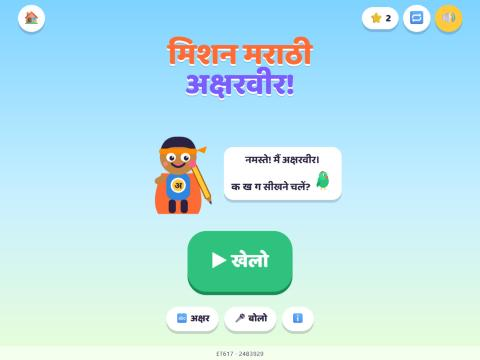
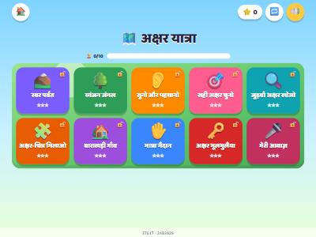
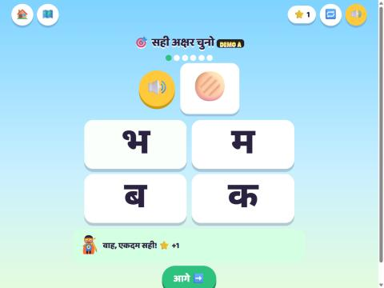
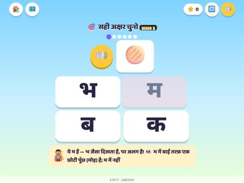
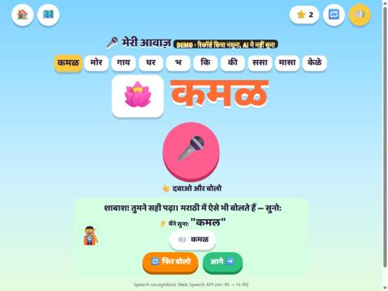
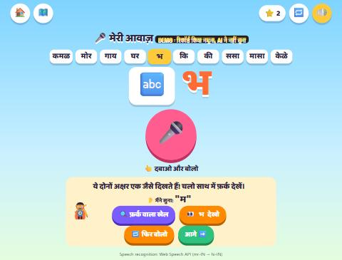
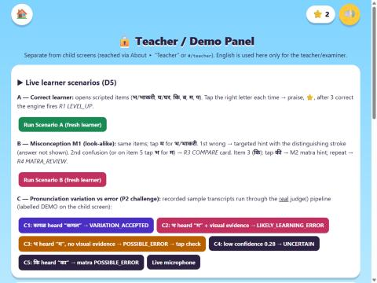

# ET 617 End-Semester Report — मिशन मराठी — अक्षरवीर! (Mission Marathi: Aksharveer!)

**Live app:** https://et617-24b3929.vercel.app · **Repository:** https://github.com/vedikaborse/et617-endsem-24B3929

## Identity card

| Field | Value |
|---|---|
| Name / GitHub | Vedikaborse / vedikaborse |
| Roll number (identity token) | **24B3929** (footer of every screen: `ET617 · 24B3929`, and About screen) |
| P | **P2** Contextual language and literacy application (NLP) |
| T | **P2-T1** Marathi: barakhadi / matra recognition for early readers |
| L | **L2** First-generation learner, low-income settlement, NGO after-school centre with shared tablets |
| C | **C2** Learner's own language (Hindi): all learner-facing text and feedback in Hindi; English optional |

## D1 — Educational problem

Children of Hindi-speaking migrant families in Niphad taluka (Nashik) study in Marathi-medium schools but hear only Hindi at home. By Grade 3 many cannot reliably recognise Marathi letters. They confuse look-alike letters (घ/ध, भ/म, ब/व, प/ष) and do not notice that a matra changes a consonant's sound (क → का → कि → की). Marathi classroom explanations do not get through to them, and being corrected in front of peers makes them stop trying. Their NGO after-school centre has shared Android tablets and weak internet, but no app that explains Marathi letters **in Hindi**, works mainly through listening, and lets the child read aloud without being penalised for a Hindi accent.

**Learning outcomes (measurable, assessed in-app):**
1. **Identify** the correct Marathi letter after hearing its sound, from 3–4 choices that include a look-alike distractor, with ≥ 80 % accuracy over 10 items (Games 1, 2, 3, 7).
2. **Distinguish** barakhadi forms of one consonant (e.g. कि / की / के / का) after hearing a syllable, and **place** the correct matra to build it, with ≥ 75 % accuracy over 8 items (Game 2 matra mode, Games 5, 6).
3. **Associate** a letter or syllable with a familiar picture-word (क–कमळ, मो–मोर, गा–गाय) with ≥ 4/5 correct matches, and **read aloud** 3 of 5 target words in a way the variation-tolerant speech check accepts (Games 4, 8).

**Context of use:** NGO after-school centre, 4–6 pm, a 15-minute turn on a shared 8-inch Android tablet in Chrome, sometimes offline. Occasionally a parent's phone at home.

## D2 — Learner persona

**Arjun Prajapati, 8 years, Grade 3**, Zilla Parishad Marathi-medium school, Niphad, Nashik.
- **Background (L2):** first in his family to go to school. The family came from Uttar Pradesh: his father loads onion sacks at Lasalgaon APMC and his mother works in grape vineyards. They live in a low-income workers' settlement and Arjun goes to the NGO centre after school. *(The L2 seed says "urban low-income settlement". My scenario is a semi-urban labour settlement in Niphad. The L2 features I design for are the same: first-generation learner, NGO centre, shared tablets.)*
- **Language:** Hindi at home. He follows a little spoken Marathi but cannot read Marathi or Hindi instructions. His speech has no ळ sound, so he says "कमल" for कमळ.
- **Prior knowledge:** recognises about 8–10 Devanagari shapes (क, म, र, स, अ, आ). He has not learned the barakhadi and treats का as क.
- **Device / time:** shared tablet, about 15 minutes a turn, 4 days a week. No login and no personal data. Teachers reset the device between children.
- **Motivation:** loves cartoons, superheroes and collecting stars. Wants to read his sister's Marathi storybook and village signboards.
- **Strengths:** listens well and remembers pictures. **Challenges:** cannot read instructions, low confidence, short attention span, embarrassed by mistakes.
- **Preferences:** listening over reading, big pictures, repetition, quick praise.

**Misconception M1 – look-alike letters are "the same letter":** he looks at the overall shape and misses the stroke that tells two letters apart. He reads ध as घ, म as भ, व as ब and ष as प.
**Misconception M2 – "the matra does not change the sound / the left matra comes first":** he reads का as क and mixes up ि (short, written on the left but spoken *after* the consonant) with ी (long, on the right).

## D3 — Educational content

**Concept explanation (spoken and shown in Hindi in the Letter Explorer and Barakhadi village):**
- "हर अक्षर की अपनी आवाज़ है। *क* — जैसे *कमळ* (कमल)।"
- "कुछ अक्षर एक जैसे दिखते हैं: *भ* और *म*। भ में बाईं तरफ़ एक छोटी पूँछ है; म में नहीं।"
- "मात्रा लगाने से आवाज़ बदलती है: क + ा = का। *ि* बाईं तरफ़ लिखते हैं, पर आवाज़ बाद में आती है: कि = क + इ।"

**Activity tasks (scripted demo set used in Scenarios A/B; ≥ 5 tasks, 3 formats):**

| # | Format | Task (prompt is spoken in Hindi + Marathi) | Model answer | Correct feedback | Feedback M1 | Feedback M2 |
|---|---|---|---|---|---|---|
| 1 | Picture → letter MCQ | 🫓 "भाकरी किस अक्षर से शुरू होता है?" options भ म ब क | **भ** | "वाह, एकदम सही! ⭐ +1" | chose म: "ये म है — भ जैसा दिखता है, पर अलग है! भ में बाईं तरफ़ एक छोटी पूँछ (मोड़) है; म में नहीं" (answer not revealed; retry) | – |
| 2 | Picture → letter MCQ | 🏠 घर: options घ ध प स | **घ** | praise + star | chose ध: "घ के ऊपर लकीर पूरी जुड़ी है; ध में बाईं गाँठ के ऊपर लकीर टूटी होती है" | – |
| 3 | Sound → syllable MCQ | hear "कि": options कि की का के | **कि** | praise | – | chose की: "व्यंजन सही है! 👍 अब मात्रा ध्यान से सुनो: की नहीं — आवाज़ 'इ' वाली मात्रा खोजो।" (replays कि) |
| 4 | Picture → letter MCQ | 🦆 बदक: options ब व म र | **ब** | praise | chose व: "ब के बीच में तिरछी लकीर है; व में बीच खाली है" | – |
| 5 | Picture → letter MCQ | 🐟 मासा: options म भ स न | **म** | praise | chose भ: second भ/म confusion → **COMPARE card** shows भ and म side by side with the difference, tap each to hear it | – |
| 6 | Drag / tap-to-place | 🦚 म ▢ र — drag the right matra into the slot (ो, ा, ौ) | **ो → मोर** | "शाबाश! म + ो = मो" + word spoken | – | placed ा: "ये बना 'मा' — आवाज़ 'आ' वाली। शब्द फिर सुनो और दूसरी मात्रा आज़माओ!" |
| 7 | Matching | tap letter, then its picture (क–🪷, ग–🐄, स–🐇, घ–🏠) | pairs | "सारी जोड़ियाँ बन गईं!" | wrong picture: "ये ससा है। सुनो, इसकी पहली आवाज़ क्या है?" | – |
| 8 | Speak aloud | 🪷 say "कमळ" | कमळ (कमल accepted) | "शाबाश! तुमने सही पढ़ा। मराठी में ऐसे भी बोलते हैं — सुनो: कमळ" | see D7 / D5-C | – |

**Scaffolding ladder (no answer on the first error):** 1st error → targeted hint about the distinguishing stroke or matra sound, and the wrong option fades → 2nd error → correct option glows gently, audio replays, "आगे" appears → repeated pattern → adaptation rule (COMPARE / MATRA_REVIEW / SIMPLIFY).

## D4 — Working application (URL, screen map)

**URL:** https://et617-24b3929.vercel.app (Vercel, static React app). Repo: https://github.com/vedikaborse/et617-endsem-24B3929

```
Home (#/) ──▶ Journey Map (#/map) ── all 10 zones unlocked ──┐
  │  ▶ खेलो / 🔤 / 🎤 / ℹ️                                      │
  ├─▶ Letter list (#/letters/swar|vyanjan) ─▶ Letter Explorer (#/letter/क) ─▶ Barakhadi (#/barakhadi/क)
  ├─▶ Game 1 सुनो और पहचानो (#/game/g1)   Game 2 सही अक्षर चुनो (#/game/g2, matra mode ?m=1)
  ├─▶ Game 3 जुड़वाँ अक्षर खोजो (#/game/g3) Game 4 अक्षर-चित्र मिलाओ (#/match)
  ├─▶ Game 5 बाराखड़ी गाँव (#/barakhadi/क) Game 6 मात्रा मैदान drag/tap-place (#/place)
  ├─▶ Game 7 अक्षर भूलभुलैया (#/maze)      Game 8 मेरी आवाज़ speech (#/speak)
  └─▶ Reward (#/reward) ─▶ replay / map
About (#/about) ─▶ Teacher / Demo panel (#/teacher)  [kept off the child home screen]
```
Every screen has a 🏠 home button, a 🔁 repeat-audio button, a 🔊/🔇 mute toggle, the star counter, and the footer **ET617 · 24B3929**.
**C2 visibly implemented:** all child-facing instructions, hints, feedback, rewards and errors are short spoken-style Hindi and are also spoken aloud (hi-IN TTS). Marathi appears only as the learning content (letters, syllables, words). English appears only on the About and Teacher screens, which are for adults.

Screens:  

## D5 — Two contrasting learner scenarios (run on the live app)

Started from the Teacher panel ("Run Scenario A/B"), which resets the learner and opens Game 2 with the scripted items from D3.

**(a) Correct learner:** taps **भ** for 🫓 भाकरी → green feedback "वाह, एकदम सही! ⭐ +1", star counter goes up, "आगे" appears. After 3 first-try correct answers, rule **R1 LEVEL_UP** fires ("🚀 लेवल ऊपर!"): the next generated items have 4 options with a look-alike distractor.


**(b) Misconception M1:** taps **म** for 🫓 भाकरी → म shakes and fades, the answer is **not** shown, and the mascot gives a targeted hint: "ये म है — भ जैसा दिखता है, पर अलग है! भ में बाईं तरफ़ एक छोटी पूँछ (मोड़) है; म में नहीं". The child retries. When the same भ/म confusion happens again (item 5), rule **R3 COMPARE** opens a side-by-side भ | म comparison card. Two wrong in a row triggers **R2 SIMPLIFY** (2 options + picture hint). On item 3, choosing की for कि (M2) gives the matra hint, and a repeat fires **R4 MATRA_REVIEW**, which links to the barakhadi village.


**(c) P2 challenge — pronunciation variation vs learning error** (Speech screen; recorded sample transcripts are run through the real `judge()` code and labelled **DEMO** on screen):
- **Variation accepted:** target कमळ, recogniser hears "कमल" (conf 0.82) → rule V1 ळ→ल → `VARIATION_ACCEPTED`: "शाबाश! तुमने सही पढ़ा। मराठी में ऐसे भी बोलते हैं — सुनो: कमळ". A star is awarded and the ळ sound is modelled.

- **Learning error:** target भ, recogniser hears "म" (0.77), **and** the learner model has 2 visual confusions भ/म from tap games → `LIKELY_LEARNING_ERROR`: "ये दोनों अक्षर एक जैसे दिखते हैं! चलो साथ में फ़र्क देखें" + buttons to the comparison game and the letter explorer.

- Same "म" with **no** visual evidence → `POSSIBLE_ERROR`: the child is asked to tap the letter. Tapping भ correctly reclassifies it as a speech/recognition difference, not an error. Confidence 0.28 → `UNCERTAIN`: "मैं ठीक से सुन नहीं पाया…", which is never marked wrong.



## D6 — AI functionality specification

### AI-1: Speech recognition (NLP) — `src/lib/speech.js`
- **What it does:** transcribes the child reading a Marathi word or syllable aloud.
- **Model call (actual code):**
  ```js
  const rec = new (window.SpeechRecognition || window.webkitSpeechRecognition)();
  rec.lang = 'mr-IN'; rec.maxAlternatives = 5; rec.interimResults = false; rec.continuous = false;
  rec.start();  // retried with 'hi-IN' if 'language-not-supported'
  ```
  In Chrome/Edge the browser streams the audio to the browser vendor's cloud speech service. There is no app backend and no API key.
- **Input:** about 7 s of microphone audio. **Output:** up to 5 `{transcript, confidence}` alternatives in Devanagari. Chrome on Android often reports confidence 0, which the app treats as "not reported", not as low.
- **How the output is checked before the learner sees it** (`judge()`; deterministic and logged with a trace):
  1. Normalise (NFC, strip spaces/punctuation/ZWJ).
  2. Exact match of the target in any alternative → `CORRECT`.
  3. Match after acceptable-variation rules → `VARIATION_ACCEPTED`. Rules: V1 ळ→ल (Hindi has no ळ), V2/V3/V7/V8 short/long i and u (length is weakly contrasted in everyday speech), V4 ण→न, V5 श/ष→स, V6 chandrabindu→anusvara.
  4. Confidence < 0.45 → `UNCERTAIN` (never judged).
  5. Transcript begins with a look-alike of the target → check **visual evidence** in the learner model: ≥ 2 visual confusions → `LIKELY_LEARNING_ERROR`, otherwise `POSSIBLE_ERROR` → ask the child to tap the letter. Same consonant with a different matra → `POSSIBLE_ERROR` (matra).
  6. Unrelated → `TRY_AGAIN` (model the sound, no penalty, no error logged).
- The child sees only the short Hindi message for that decision plus "मैंने सुना: …". The raw trace appears only in the Teacher panel.
- **If it is wrong:** the bias is towards not punishing. A recogniser error can at worst produce `UNCERTAIN`, `TRY_AGAIN` or a tap-check, never a "wrong" mark. A literacy error is only concluded when the visual tap tasks agree.
- **If the service fails** (unsupported browser such as Firefox, offline, mic denied, network error): the app switches to a manual mode labelled **"बिना माइक वाला खेल · कोई AI जाँच नहीं"** (listen → say aloud → tap 👍). It does not claim the voice was evaluated.
- **Demo / recorded samples:** the Teacher panel injects recorded sample transcripts (`SAMPLE_OUTCOMES`) into the same `judge()` function. The child screen shows a black **DEMO · रिकॉर्ड किया नमूना, AI ने नहीं सुना** badge, and the Teacher log marks them "SIMULATED sample".

### AI-2: Speech synthesis — `src/lib/audio.js`
`speechSynthesis` with a mr-IN voice if the device has one, else a hi-IN voice reading the Devanagari, else silent with visual cues (pulsing speaker, captions). A 6 s safety timeout means the game never waits on TTS. The Teacher panel shows which voices were found.

### Adaptive engine (rule-based, not ML) — `src/lib/model.js`
R1 3 correct → LEVEL_UP · R2 2 wrong → SIMPLIFY · R3 same look-alike pair ×2 → COMPARE · R4 matra errors ×2 on a consonant → MATRA_REVIEW · R5 ≥ 3 hints → EASIER. Inputs: the logged answers, error type (classified as look-alike / matra / other), response time and hints. Every firing is logged with its rule ID in the Teacher panel.

## D7 — Pedagogical rationale

- **Game, not worksheet:** short rounds (6 items), stars, a hero mascot, a treasure maze and confetti keep an 8-year-old with low confidence engaged. Mistakes cost nothing: no lives, no red crosses, no score loss.
- **Visual recognition is taught, not just tested:** the look-alike pairs are named, each has a one-line Hindi description of the distinguishing stroke, the COMPARE card puts the two letters side by side, and Game 3 (find the twin) and the maze practise discrimination with distractors that get harder.
- **Audio first:** every prompt is spoken, there is a 🔁 on every screen, and letters and words are tappable to hear them. Arjun learns by listening, and sound–symbol association (LO1) needs the sound.
- **Why Hindi for instruction (C2):** Arjun cannot follow Marathi instructions, and Hindi is the language he understands without effort. So the *what to do* is in simple spoken Hindi ("सही अक्षर पर टैप करो!", "चलो, फिर कोशिश करते हैं!") and the *what to learn* is Marathi. Hindi glosses of words (कमळ → कमल, झाड → पेड़) connect new Marathi vocabulary to words he knows. Because Hindi uses the same script, he can also carry over shapes he already knows, and the app flags where Marathi differs (ळ, Marathi words).
- **How Marathi is introduced:** स्वर and व्यंजन with picture words from his surroundings (कांदा onion – Lasalgaon, ऊस sugarcane, भाकरी, गाय, मोर, चिमणी), then matras one at a time in the barakhadi village (consonant + matra = syllable, with ि's left-written/right-spoken rule shown explicitly), then words.
- **Scaffolding and feedback:** a targeted hint on the 1st error (M1: the distinguishing stroke; M2: "the consonant is right, change the matra"), a gentle reveal on the 2nd, then an adaptive route. Praise is specific and varied.
- **Repetition and free exploration:** every zone is unlocked from the start, letters can be explored in any order, and any game can be replayed. The map is for motivation, not a gate.
- **Avoiding shame:** private tablet play, no failure sounds beyond a soft tone, and the mascot "thinks" instead of frowning. Speech is never marked wrong on recogniser evidence alone.
- **Adaptive difficulty:** uses performance (correct/wrong streaks, error type) and interaction (hint requests) to change the number of options, distractor type and route (R1–R5). The rules are visible in the Teacher panel.
- **Rural context / L2:** pictures and words are chosen from village and farm life. Emoji and SVG keep the bundle small (~70 KB gzipped JS) for weak internet. There is no login and no personal data on shared tablets, and the Teacher panel has a one-tap reset. Turns are 15 minutes and rounds are short.
- **P2 design challenge — error vs variation:** the app combines two kinds of evidence. *Speech evidence* is never enough on its own to call something a literacy error, because (i) known L1-Hindi substitutions (ळ→ल, ण→न, श→स) and weak vowel-length contrasts are accepted as **pronunciation variation** (example: कमळ said as "कमल" → accepted, with praise and a model of ळ), and (ii) low or unreported confidence is treated as **recogniser uncertainty** ("मैं ठीक से सुन नहीं पाया"). A **learning error** needs agreement with *visual evidence*: the child hears "म" for भ **and** has chosen म for भ in tap games (example → LIKELY_LEARNING_ERROR → comparison practice). When only speech suggests an error, the child is asked to tap the letter, which encourages self-correction and lets the app reclassify. Honest limit: the variation rules are conventional patterns for Hindi-speaking learners of Marathi. They are not a validated dialect model, and the uncertainty case is labelled as recogniser uncertainty, not a dialect claim.

## D8 — Evaluation plan (planned, not yet conducted)

| Outcome | Assessment activity | Learner does | Data logged (local, anonymous) | Success |
|---|---|---|---|---|
| LO1 identify | 10-item sound→letter test (Game 1 at level 2: 4 options incl. look-alike) pre and post | hears, taps letter | correct/incorrect, chosen distractor, look-alike pair, response ms, attempts | ≥ 80 % first-try correct; look-alike errors fall by ≥ 50 % from pre-test |
| LO2 matras | 8 items: Game 2 matra mode (4) + Game 6 placement (4) | hears syllable, chooses or places matra | target vs chosen matra, matra error count per consonant, hints | ≥ 75 % correct; ि/ी confusions ≤ 1 |
| LO3 associate/read | Game 4 match (5 pairs) + Game 8 read aloud (5 words) | matches; reads aloud | matches, speech decisions (CORRECT/VARIATION/UNCERTAIN/ERROR), transcripts | ≥ 4/5 matches; ≥ 3/5 words CORRECT or VARIATION_ACCEPTED |

Also collected: hint usage, number of rounds completed, adaptation rules fired, and time on task. **Design:** a pre-test, 2 weeks of use (4 × 15 min/week) at the NGO centre with about 15 children, a post-test, and a **retention test 1 week later**. A facilitator records a short rubric observation of confidence (willing to try / asks for help / gives up). **Overall success criterion:** ≥ 70 % of children reach all three thresholds at post-test and keep ≥ 80 % of their gain at retention. No names: the device logs are exported by the teacher under a code number. *No evaluation with children has been carried out yet. Only functional testing by the developer was done (D5).*

## AI-use log and reflection

**Tools used, in order:** Claude Code (Anthropic Claude, desktop app) in a single session on 18 Nov 2026, from about 19:00 IST. Export/share link of this chat: *(to be attached on Moodle by the student)*.

- **Planning:** I gave Claude my exam card, my persona details (Grade 3, Niphad, Hindi at home) and the exam PDF. Claude drafted DESIGN.md (problem, outcomes, persona, misconceptions, plans), which was committed as the first commit.
- **Content generation:** Claude proposed the Marathi word list, look-alike pairs, matra names and Hindi feedback text. I reviewed it for the card. Words were chosen from conventional Marathi alphabet-chart examples (कमळ, घर, ससा, हत्ती…). Where no common initial word exists (ङ, ञ, ण, ळ), none was invented.
- **Coding:** Claude wrote the React/Vite code, the speech judge, the adaptation engine and the CSS, then built, committed and deployed to Vercel through the CLI.
- **UI design:** Claude designed the original SVG mascot (अक्षरवीर) and the parrot (मिठू), the map and the colour system.
- **Debugging and testing:** Claude tested on the live URL in a browser pane (Scenario A, B, C screenshots). It found that look-alike confusions were counted in one direction only, so the COMPARE rule fired late, and made the counting symmetric.
- **Reflection:** AI made a 2-hour build of 8 games possible, but its output needed checking against the card (C2: no English on child screens) and against linguistic accuracy. The variation rules are presented as conventional patterns, not as research findings. The speech feature is described honestly: it depends on the browser's cloud recogniser, has a labelled non-AI fallback, and sample outcomes are always marked DEMO. Not done: no real-child testing, and the Marathi TTS quality depends on the device's voices.
